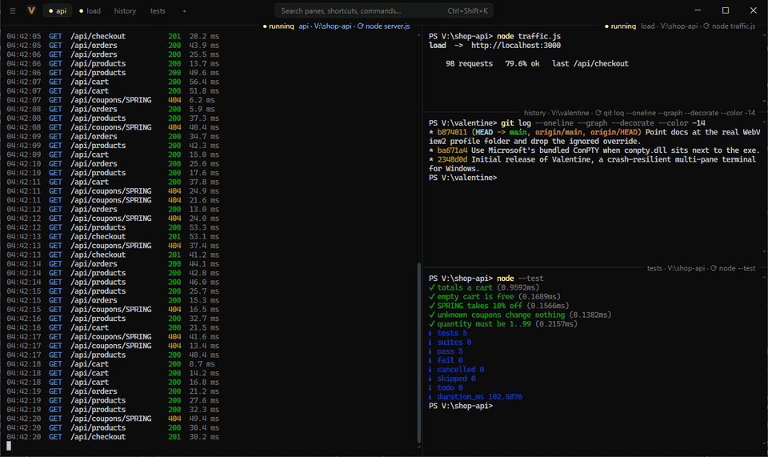
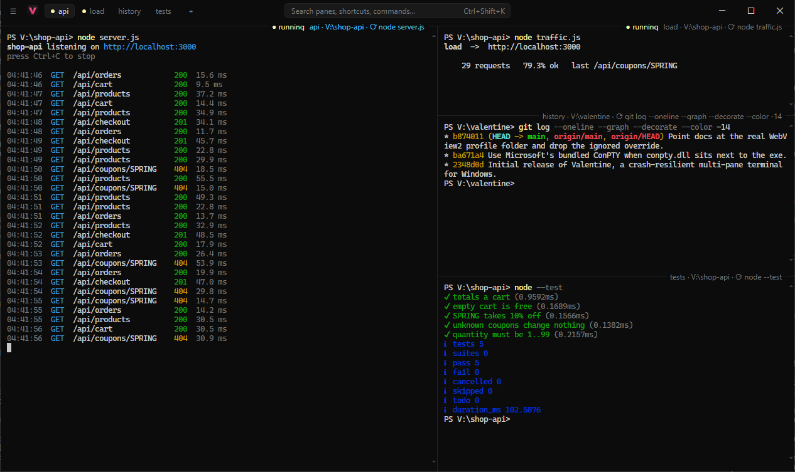

<p align="center"></p>

<h1 align="center">Valentine</h1>

<p align="center">A multi-pane terminal for Windows, macOS and Linux that survives power cuts.</p>

<p align="center">
  <a href="https://github.com/Tuntii/valentine/releases/latest"></a>
  <a href="https://github.com/Tuntii/valentine/actions/workflows/release.yml"></a>
  
  <a href="LICENSE"></a>
  <a href="https://www.conventionalcommits.org"></a>
</p>

<p align="center"></p>

When the PC goes down hard, every open terminal goes with it: the panes, their folders, their
scrollback, the dev servers you had running. Valentine keeps all of that in a SQLite database as
you work, and on the next start puts it back: same layout, same folders, scrollback restored,
startup commands re-run and Claude Code conversations resumed.

## Features

- **Split anything.** Panes form a free split tree, like Windows Terminal; drag the 1px dividers.
  Presets for 2×2, 3+2 and 1+3.
- **Crash-proof state.** Layout, each pane's folder and its scrollback are written continuously
  (SQLite in WAL mode). After an unexpected shutdown every pane is marked
  `RESTORED AFTER UNEXPECTED SHUTDOWN` and its shell starts in the folder it was in.
- **Startup commands.** Give a pane a command such as `npm run dev`; after a restore it runs
  after a 3-second countdown you can cancel with Esc.
- **Per-pane history.** PowerShell, bash and zsh keep a separate command history per pane.
- **Any shell.** PowerShell (pwsh if installed), cmd, Git Bash or WSL on Windows; zsh, bash or
  fish on macOS and Linux.
- **Command status.** A pane's label shows when a background command is running, finished or
  failed, with its exit code.
- **Claude Code aware.** Claude in a pane gets a status badge (working / your turn / needs you)
  and is resumed after a crash. Shift+Enter inserts a newline.
- **Agents can drive Valentine.** A built-in MCP server lets Claude Code, OpenCode, Grok and
  other agents list panes, read their output, run commands and talk to each other
  (`ask_agent`).
- **Offline.** The UI (xterm.js) is compiled into the binary.

<p align="center"></p>

## Install

Download the archive for your system from the
[latest release](https://github.com/Tuntii/valentine/releases/latest) and run `valentine`
from it.

| | |
|---|---|
| **Windows** | `valentine-windows-x64.zip`. Ships with Microsoft's current ConPTY (`conpty.dll` + `OpenConsole.exe`), which Windows 10's built-in one is years behind; keep them next to the exe. Uses the WebView2 runtime, or an Edge app window without it. |
| **macOS** | `valentine-macos-arm64.tar.gz` (Apple silicon). The binary is not notarized yet: run `xattr -d com.apple.quarantine valentine` once. |
| **Linux** | `valentine-linux-x64.tar.gz`. Needs GTK 3 and WebKitGTK 4.1: `sudo apt install libgtk-3-0 libwebkit2gtk-4.1-0` (Debian/Ubuntu), `sudo dnf install webkit2gtk4.1` (Fedora). |

To build it yourself, see [CONTRIBUTING.md](CONTRIBUTING.md#building).

## Using it

| | |
|---|---|
| Split right / down | `Alt+Shift+=` (or `Alt+Shift+D`) / `Alt+Shift+-` |
| Move between panes | `Alt+Arrow` |
| Resize | `Alt+Shift+Arrow`, or drag a divider |
| Maximize / restore | `Ctrl+Shift+Enter` |
| Close / reopen pane | `Ctrl+Shift+W` / `Ctrl+Shift+T` |
| Copy / paste | `Ctrl+C` with a selection / `Ctrl+V` (`Cmd` on macOS) |
| Open a link | `Ctrl+Click` (`Cmd+Click` on macOS) |
| Everything else | right-click a pane: rename, startup command, shell, layouts, start at login, `git pull` / `git merge` in a repo, open the local server its command started |
| Ports, HTTP requests | sidebar (`Ctrl+Shift+B`): who listens on which port (open / kill), a small request runner |

Double-click a pane's label to rename it.

## Agents

Inside Valentine, `claude` automatically loads Valentine's hooks and MCP server for that session
only; your own Claude Code settings are not touched. To give other agents the same tools,
register the server once:

```
grok mcp add -s user valentine "/path/to/valentine" -- mcp
opencode mcp add --global valentine -- "/path/to/valentine" mcp
```

Tools: `list_panes`, `read_pane`, `run_command`, `send_text`, `open_pane`, `close_pane` and
`ask_agent`, which types a message into another agent's pane and returns its answer.

## Where things live

Valentine's state (the database and per-pane histories) is in

| | |
|---|---|
| Windows | `%APPDATA%\Valentine` |
| macOS | `~/Library/Application Support/Valentine` |
| Linux | `$XDG_CONFIG_HOME/Valentine` (`~/.config/Valentine`) |

Delete the folder to start from scratch. On Windows the window's WebView2 profile is in
`%APPDATA%\valentine.exe` (named after the exe by the webview library).

## Contributing

Issues and pull requests are welcome; see [CONTRIBUTING.md](CONTRIBUTING.md). Releases are cut
automatically from [Conventional Commits](https://www.conventionalcommits.org) on `main`.
Security problems: please follow [SECURITY.md](SECURITY.md).

## License

MIT, see [LICENSE](LICENSE). xterm.js is MIT licensed, see
[src/ui/vendor/LICENSE-xterm](src/ui/vendor/LICENSE-xterm).
